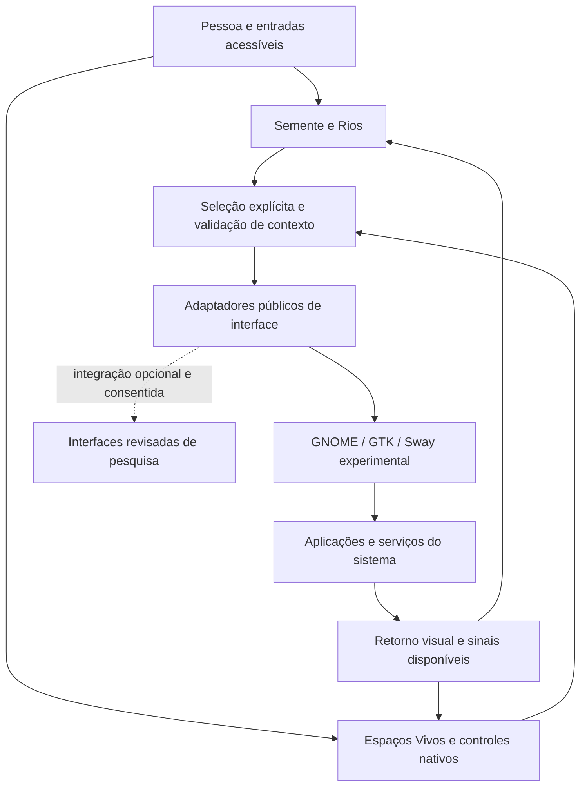

# Arquitetura pública e contribuições de pesquisa — ARANDU TAPE

Revisão 0.1, 24/11/2026. Texto de posicionamento científico para a primeira versão arquivada. Não é artigo revisado por pares, prova de novidade mundial nem exposição da ontologia interna.

## 1. Objeto e problema

O ARANDU TAPE investiga como organizar um ambiente gráfico Linux em que a interface torne ações disponíveis conforme o contexto e a intenção, sem esconder caminhos de recuperação, comprometer a autonomia ou exigir serviços de inteligência artificial. A unidade de investigação é a experiência de interação com o ambiente e seus componentes públicos; não a implementação de um mecanismo cognitivo privado.

Pergunta orientadora: em tarefas equivalentes, uma gramática espacial contextual que preserva caminhos reconhecíveis e revela opções progressivamente pode favorecer orientação, autonomia e eficiência sem aumentar erros de interação, custo computacional ou barreiras de acessibilidade?

A questão é uma hipótese de pesquisa, não um resultado demonstrado.

## 2. Arquitetura pública e fronteiras

Diagrama conceitual: as caixas representam responsabilidades, não um único processo executável. GNOME, GTK e Sway são tecnologias de terceiros; seus papéis e versões não são intercambiáveis. A arquitetura não reivindica um compositor próprio. A interface pública deve conservar as funções essenciais sem depender da caixa opcional de pesquisa. Esta independência é requisito de aceite, ainda a verificar integralmente.

| Camada | Responsabilidade | Evidência pública |
| --- | --- | --- |
| Linguagem espacial | Semente, Rios, medalhões, gramática de controles e variantes | [Design Core](DESIGN_CORE.md) |
| Navegação | Seleção e retorno explícitos; contexto de memória operacional, abertos e frequentes | [Confluência](../ARANDU-SUITE/Confluencia/) |
| Intenção | Classificar ações, fixar identidade do alvo, exigir autorização | [Contrato Python](../ARANDU-DESKTOP/window_gestures.py), [contrato JS](../ARANDU-SUITE/Confluencia/design-reference/window-intent-gate.mjs) |
| Execução espacial | Adaptador GNOME 46 de operações nativas e prévia | [Laboratório](../ARANDU-SUITE/Confluencia/spaces-lab/) |
| Interface alternativa | Protótipo GTK4, Opy e laboratório de sessão Sway | [Desktop](../ARANDU-DESKTOP/) |
| Estado e sinais | Preferências e histórico local, avisos nativos e limites da observação | [Privacidade](PRIVACIDADE.md), [sinais GNOME](SEMENTE_SINAIS_GNOME.md) |
| Pesquisa | Somente interfaces previamente aprovadas; implementação interna fora do depósito pretendido | [Política Zenodo](PUBLICACAO_CIENTIFICA_ZENODO.md) |

Não assumir que todos os módulos pertencem à mesma sessão, nem que os gestos da Alça Viva já estão conectados a todas as janelas. Distinguir painel transitório de janela real.

## 3. Contribuições propostas e evidência necessária

| Contribuição de projeto | Distinção pretendida | Evidência necessária |
| --- | --- | --- |
| Semente Adaptativa e Rios | Organização relacional de navegação por trajetórias, com referência visual recuperável | Observação de orientação, retomada e erros em tarefas equivalentes |
| Espaços Vivos | Combinação de controles contextuais, prévia transparente, autorização explícita e gramática direcional de oito bordas/cantos mais Flecha Mestre | Geometria, precisão, legibilidade, latência, ações involuntárias e comparação de uso |
| Presença Viva | Variação localizada da saliência do controle por aproximação e permanência, sem executar ação por tempo | Descoberta dos controles, estabilidade, nitidez, tempo de seleção e alternativas acessíveis |
| Alça Viva e Cabeçalho Vivo | Organização coerente de gestos e áreas de interação, com distinção entre janelas e painéis | Teste das operações reais, recuperação de foco, não sobreposição e cancelamento |
| Autonomia e baixo custo | Integração opcional de pesquisa, privacidade e recuperação; funções essenciais independentes | Teste sem IA, sem credenciais e sem núcleos privados; CPU/RAM/latência comparáveis |

O interesse científico está na combinação e operacionalização desses princípios no contexto do ARANDU. Redimensionamento, gestos, revelação contextual, ícones e adaptação possuem antecedentes conhecidos; não se reivindica invenção isolada dessas técnicas. Uma revisão sistemática ou de escopo é necessária antes de afirmar originalidade frente ao estado da arte. Os nomes autorais descrevem componentes do projeto, não certificam novidade, direitos exclusivos ou autenticidade cultural.

## 4. Articulação teórica

Ausubel (2000) investiga a formação de novos significados na interação entre material de aprendizagem e ideias relevantes da estrutura cognitiva. O ARANDU usa essa referência como heurística de organização e continuidade, não como modelo psicológico comprovado de um computador. Diferenciação progressiva orienta a apresentação de ações e detalhes; reconciliação integrativa inspira a articulação de caminhos sem fragmentar a orientação. Nenhuma métrica de frequência de abertura comprova compreensão ou aprendizagem significativa.

A manipulação direta descrita por Shneiderman (1982, 1983) é antecedente relevante para ações sobre objetos visíveis, retorno rápido e alterações incrementais e reversíveis. O contorno e a prévia dos Espaços Vivos são decisões de projeto relacionadas a essa tradição. O referencial ISO 9241-11:2018 permite organizar a avaliação de usabilidade em torno de efetividade, eficiência e satisfação no contexto definido. Usar esse referencial não significa certificar conformidade com a norma.

Distinguir três níveis: (a) aprendizagem humana, que requer evidência de significados e retenção; (b) aprendizagem do uso da interface, investigada por tarefas, retomada e transferência; (c) adaptação computacional, investigada por mecanismos e métricas próprios. O depósito gráfico não valida automaticamente nenhum dos três. O contrato público de ações (`ARANDU-DESKTOP/action_contract.py`) é uma camada independente de autorização por intenção humana, não uma implementação da ontologia de pesquisa.

## 5. Avaliação e rastreabilidade

Cada afirmação de funcionamento deve indicar componente, commit, ambiente, método e resultado. Separar teste de contrato, simulação de APIs, teste gráfico real, medida de desempenho e estudo com participantes. A aprovação de CI não substitui os demais.

Ver [protocolo de validação](VALIDACAO_FUNCIONAL_DESEMPENHO.md) e [protocolo de pesquisa em interação](PROTOCOLO_PESQUISA_INTERACAO.md). Não armazenar dados pessoais, registros de sessões ou núcleos privados no depósito. A eventual coleta com participantes dependerá de avaliação ética/institucional aplicável e consentimento.

## Referências

- AUSUBEL, D. P. The Acquisition and Retention of Knowledge: A Cognitive View. 2000. https://doi.org/10.1007/978-94-015-9454-7
- SHNEIDERMAN, B. The future of interactive systems and the emergence of direct manipulation. Behaviour & Information Technology, 1982. https://doi.org/10.1080/01449298208914450
- SHNEIDERMAN, B. Direct Manipulation: A Step Beyond Programming Languages. Computer, 1983. https://doi.org/10.1109/MC.1983.1654471
- ISO. ISO 9241-11:2018. Ergonomics of human-system interaction — Part 11: Usability: Definitions and concepts. https://www.iso.org/standard/63500.html

A fundamentação é inicial, não uma revisão exaustiva. A escolha bibliográfica foi feita para contextualizar os princípios públicos, sem atribuir à literatura a implementação autoral do ARANDU.
